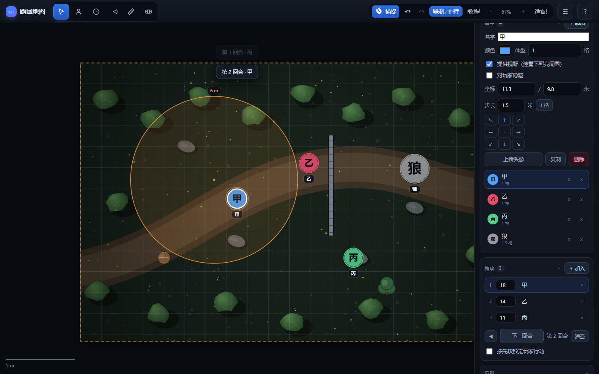

# 醉食版跑团战斗地图

> A single-file web battle map for tabletop RPGs. 一个 HTML 文件就能开团。

**在线使用（手机也能开）：<https://zuishiya.github.io/>**

## 这是什么

给 TRPG 面团 / 网团用的战斗地图：导入地图、摆棋子、画范围、算 AOE、开战争迷雾，主持人还能开房让玩家输 4 位码加入。单文件、不装软件，打开网址就能用。

适合 COC / DND / 无限流 / 战棋等规则。

## 功能

### 地图
- 导入底图自动适配视野，按图片大小整格对齐
- 自带地牢 / 洞穴 / 森林 / 酒馆四张程序化地图
- 网格颜色、粗细、浓淡可调；可拖动网格线对齐地图格子
- 任意角度旋转，地图 / 网格 / 棋子 / 范围一起转

### 棋子
- 名字、颜色、头像、体型（0.1–100 格）
- 拖拽吸附格子或棋子中心；也可输坐标、步长 + 方向键精确走位
- 多棋子列表、定位、复制、删除
- 先攻表：先攻值排序、下一回合 / 回退
- 可对玩家隐藏

### 范围与判定
- 测距线、圆、扇形；半径 0.5–5000 米、张角 1–360° 自由输入
- 起点 / 终点分别吸附棋子或格心
- 20 米射击圈、5 米 AOE 一键画
- 自动计算命中名单，画布橙色虚线圈高亮
- 范围可整体拖动；遇到墙会被切断

### 场景与障碍
- 8 种摆件（木桶 / 木箱 / 圆桌 / 椅子 / 火把 / 树 / 石像 / 地毯）
- 可导入自己的图片做自定义摆件，存进本机物品库反复使用
- 墙有厚度，挡移动、挡视线、参与范围判定

### 战争迷雾
- 手动揭雾 + 自动视野
- 每个棋子可设置视野半径、是否提供视野
- 墙按厚度挡视线；多个棋子视野取并集，不叠加变亮
- 主持人始终看全场，玩家只看自己棋子的视野

### 联机跑团
- 主持人开房得到 4 位房间码，玩家打开同一网址输码加入
- 玩家只移动自己的棋子、只看自己的视野
- 玩家测距 / 圆 / 扇形只在本机显示，不干扰主持人
- 地图、棋子、范围、先攻、摆件、迷雾实时同步
- 地图边界、按先攻锁定玩家行动

### 其它
- 撤销 / 重做（80 步）
- 导出 / 导入 JSON 存档（含底图、头像、摆件图片）
- 截图复制到剪贴板、右键 / 长按菜单
- 面板折叠、7 步新手教程、帮助弹窗
- 手机触屏：底部抽屉、双指缩放、长按菜单

## 30 秒上手

1. 打开 <https://zuishiya.github.io/>
2. 把地图图片拖进窗口，或点「地牢 / 洞穴 / 森林 / 酒馆」
3. 点工具栏「棋子」，再点地图放置
4. 按 `M` 测距、`C` 画圆、`F` 画扇形
5. 右上「联机」开房，把房间码发给玩家

## 联机怎么用

- **主持人**：右上「联机」→ 开房间 → 把 4 位码发给玩家
- **玩家**：打开同一网址 → 联机 → 输房间码和名字 → 加入

线下跑团不用联机，一台电脑也能用。

## 本地运行

下载 `index.html`，双击用浏览器打开即可，无需服务器、无需安装。

## 快捷键

| 键 | 功能 |
|---|---|
| `V` | 选择 |
| `T` | 棋子 |
| `C` | 圆 |
| `F` | 扇形 |

| `M` | 测距 |
| `G` | 网格 |
| `W` | 墙 |
| `Delete` | 删除选中 |
| `Esc` | 取消 / 回到选择 |
| `Ctrl+Z` | 撤销 |
| `Ctrl+Shift+Z` | 重做 |

## 已知限制

- 底图不进自动存档，刷新页面后需要重新导入一次（导出 JSON 会带底图）
- 物品库、用户地图预设只存在当前浏览器，换设备或清缓存会丢
- 联机没有断线重连、房间列表；玩家刷新需重新输房间码
- 玩家隐藏目前是视觉隐藏，不是服务器级数据隔离
- 先攻锁只限制移动，不强制结束回合

## 反馈

作者：醉食 · QQ `2180586028`

欢迎反馈 bug、规则适配需求和联机问题。

## 许可

暂未声明开源许可证；使用、转载或二次分发前请联系作者。
